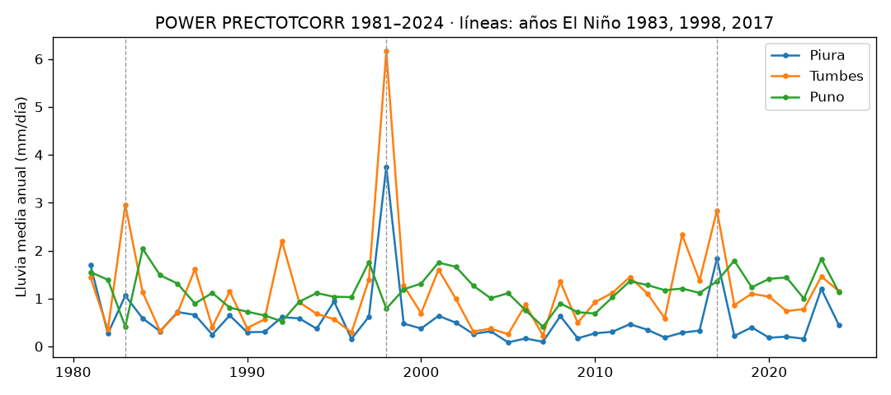

# Lab 1 — NASA POWER en 5 puntos (sin cuenta)

**Script:** `lab1_power.py` · **Bruno:** carpeta `1 POWER (Lab 1)`, peticiones 1–5 · **Periodo:** 1981–2024
**Parámetros:** `T2M, T2M_MAX, T2M_MIN, PRECTOTCORR, GWETTOP, RH2M, QV2M`

## Resultado

| Punto | Lat, lon | Respuesta | Meses | `-999` | Lluvia media (mm/día) | Años más lluviosos | Marzo 2017 (mm/día) |
|---|---|---|---|---|---|---|---|
| Piura | -5.19, -80.63 | ~1 s, 58 KB | 528 | 0 | 0,56 | 1998, 2017, 1981 | 12,88 |
| Tumbes | -3.57, -80.45 | ~1 s, 58 KB | 528 | 0 | 1,14 | 1998, 1983, 2017 | 17,82 |
| Puno | -15.84, -70.02 | ~1 s, 57 KB | 528 | 0 | 1,17 | 1984, 2023, 2018 | 2,47 |
| Lima | -12.05, -77.05 | ~1 s, 58 KB | 528 | 0 | 0,08 | 1998, 1985, 2018 | 0,52 |
| Iquitos | -3.75, -73.25 | ~1 s, 58 KB | 528 | 0 | 7,28 | 2006, 2004, 2003 | 8,14 |

## Unidades (las devuelve la API)

`T2M`, `T2M_MAX`, `T2M_MIN`: °C · `PRECTOTCORR`: mm/día · `GWETTOP`: 0–1 · `RH2M`: % · `QV2M`: g/kg

## Respuestas a la guía 12

1. **¿Llegaron las variables?** Sí, las 7.
2. **Unidades:** las de arriba.
3. **¿Hay `-999`?** Ninguno (5 puntos × 7 variables × 528 meses).
4. **Norte frente a Puno:** Piura y Tumbes muestran 1983, 1998 y 2017 (El Niño); Puno no. El contraste del Caso 1 funciona (ver gráfico).
5. **Humedad:** `RH2M` y `QV2M` funcionan. El documento 13 decide no usarlas.
6. **Tiempo:** alrededor de 1 s por punto; 25 departamentos en menos de 1 minuto.

## Hallazgos

- **Máximo 25 parámetros por consulta** (mensaje de la API).
- **La consulta regional admite como máximo 10° por lado** (`"Please provide a maximum of 10 degree range in latitude"`). Perú se pide en 4 recuadros.
- **La malla real es de 0,5° × 0,625°** (MERRA-2).
- **La elevación devuelta es la media de la celda** (Lima: 1195 m).
- **Artefacto de lluvia en Iquitos:** 12–13 mm/día de media anual en 2003–2006 (unos 4.800 mm/año, frente a unos 2.700). Ver Lab 5.
