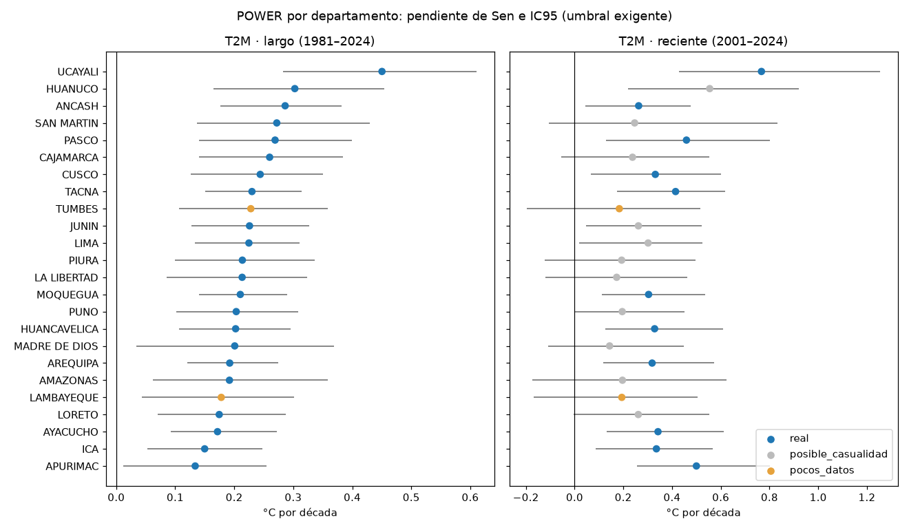
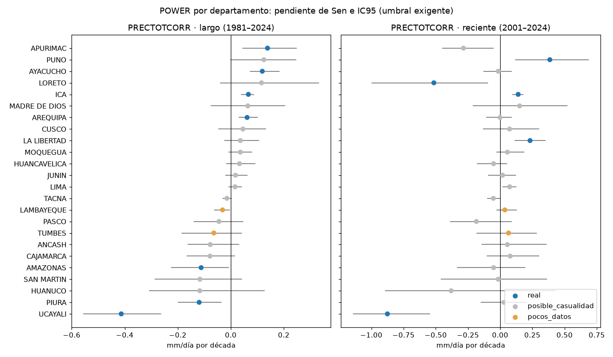

# Tendencias reales por departamento — NASA POWER (umbral exigente)

**Script:** `power_departamentos.py` · **Salida:** `resultados/power_departamentos_tendencias.csv` (contrato: `slope_per_decade`, `intercept`, `p_value`, `q_value`, `ci_low`, `ci_high`, `n_years`, `lag1`, `status`, más `year_start`, `year_end`, `pct_change_per_decade`, `celdas` y `motivo`)

## Cómo se calculó

1. Malla regional de POWER en 4 recuadros (819 celdas sobre Perú), 1981–2024, para `T2M`, `T2M_MAX`, `T2M_MIN` y `PRECTOTCORR`. Cada recuadro tarda unos 2 s.
2. Cada celda se asigna a un departamento con `regionmask`.
3. **Promedio de todas las celdas del departamento** (no un solo punto), luego media anual.
4. TFPW + Sen + IC 95 % + BH entre los 25 departamentos, por variable y periodo.
5. Umbral exigente (ver [lab5-tendencias.md](lab5-tendencias.md)). **Callao, Tumbes y Lambayeque quedan como `pocos_datos`** (0, 1 y 3 celdas).

## Resumen

| Variable | Periodo | Analizables | `real` | Suben | Bajan | Mediana de la pendiente |
|---|---|---|---|---|---|---|
| `T2M` | 1981–2024 | 22 | **22** | 22 | 0 | **+0,21 °C/década** |
| `T2M` | 2001–2024 | 22 | 11 | 11 | 0 | +0,30 °C/década |
| `T2M_MAX` | 1981–2024 | 22 | 16 | 16 | 0 | +0,24 °C/década |
| `T2M_MAX` | 2001–2024 | 22 | 8 | 8 | 0 | +0,35 °C/década |
| `T2M_MIN` | 1981–2024 | 22 | 20 | 20 | 0 | +0,16 °C/década |
| `T2M_MIN` | 2001–2024 | 22 | 0 | — | — | +0,23 °C/década |
| `PRECTOTCORR` | 1981–2024 | 22 | 7 | 4 | 3 | +0,03 mm/día/década |
| `PRECTOTCORR` | 2001–2024 | 22 | 5 | 3 | 2 | +0,01 mm/día/década |

## Temperatura (`T2M`, 1981–2024)

- **Sube en todos los departamentos analizables y en todos con estado `real`.**
- Los que más suben: **Ucayali +0,45**, Huánuco +0,30, Áncash +0,29, San Martín +0,27 y Pasco +0,27 °C por década.
- Los que menos: Apurímac +0,13, Ica +0,15 y Ayacucho +0,17.
- **Desde 2001 el ritmo es mayor** (mediana +0,30), pero solo 11 pasan el umbral: 24 años dan menos potencia. Coincide con la "vista rápida" de Favio (el ritmo casi se duplica desde 2000).

## Lluvia (`PRECTOTCORR`, tercera opinión, no para la ficha)

| Departamento | 1981–2024 | 2001–2024 | Lectura |
|---|---|---|---|
| Ucayali | **−0,41 mm/día/déc (−10 %) real** | **−0,88 (−24 %) real** | Baja en los dos periodos. Revisar con IMERG |
| Piura | **−0,12 (−14 %) real** | +0,03 (no significativa) | Se invierte según el periodo |
| Amazonas | **−0,11 (−5 %) real** | −0,05 (no significativa) | Baja en el periodo largo |
| Ica | **+0,07 (+29 %) real** | **+0,14 (+50 %) real** | Sube en los dos (desierto: mucho % sobre una base pequeña) |
| Arequipa | **+0,06 (+13 %) real** | 0,00 | Sube en el periodo largo |
| Ayacucho | **+0,12 (+12 %) real** | −0,02 | Sube en el periodo largo |
| Apurímac | **+0,14 (+8 %) real** | −0,29 (q = 0,06) | **Se invierte** |
| Puno | +0,13 (IC incluye 0) | **+0,39 (+18 %) real** | Sube desde 2001 |
| La Libertad | +0,04 | **+0,23 (+32 %) real** | Sube desde 2001 |
| Loreto | +0,12 (`lag1` 0,54) | **−0,51 (−8 %) real** | Se invierte |
| Lima | +0,02 (`lag1` 0,55) | +0,07 (`lag1` 0,70) | Excluida por autocorrelación |

**Coincide con la vista rápida de Favio:** Ica sube en los dos periodos, Amazonas baja, y Apurímac, Loreto y Piura se invierten.

## Cuidado al usar esto

- POWER es **MERRA-2 (un modelo)**, no una medición. Hay que decirlo en la ficha.
- La lluvia de POWER es la variable más floja: **no va en la ficha.** Sirve para comparar cuando se procese IMERG.
- `T2M_MIN` 2001–2024 no tiene ningún `real`, aunque la pendiente sea positiva. Es un ejemplo de por qué no conviene rebajar el umbral.
